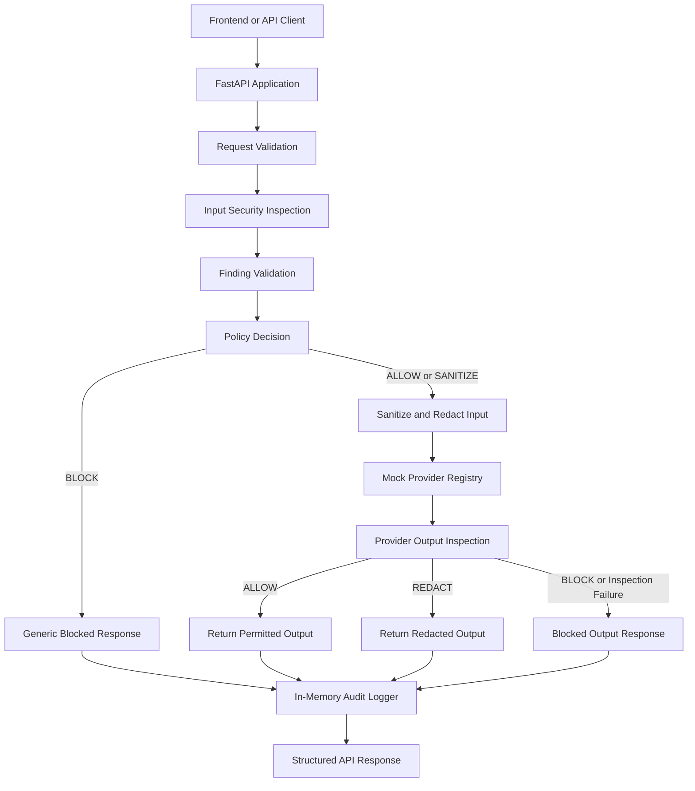

# AegisGate Architecture

## 1. Overview

AegisGate is designed to sit between a user-facing application and an AI model provider. Its purpose is to inspect incoming messages, apply security policies, inspect provider output, and return only a permitted response.

The current implementation provides a working FastAPI chat-security pipeline backed by deterministic mock providers.

**Architecture principle:** A request must not proceed to a provider after being blocked, and provider output must not be returned unchecked when output inspection fails.

## 2. Current system architecture

The diagram represents the current chat pipeline at a conceptual level. Request validation, input inspection, policy evaluation, provider invocation, output inspection, and audit-event collection are implemented components. The precise response and error behavior is defined by the application schemas and route handlers.

## 3. Implemented request lifecycle

### Step 1: Request validation

The FastAPI application validates the incoming chat request using Pydantic schemas.

The request includes a message and can specify a provider selection through `model_id`. The schema also accepts `use_rag` and an optional `conversation_id`; accepting these fields does not mean retrieval or conversation persistence is implemented.

### Step 2: Input security inspection

The input inspection layer looks for security-relevant patterns, including:

- Sensitive personal-data candidates.
- API-key and secret-like patterns.
- Prompt-injection signals.
- Credential-related requests.

Detectors produce findings that are validated before policy decisions rely on them.

Detection is rule-based and cannot guarantee identification of every sensitive value or attack.

### Step 3: Policy decision

The policy layer determines how the request should be handled.

| Action | Behavior |
|---|---|
| `ALLOW` | Permit processing, with applicable sensitive-data redaction |
| `SANITIZE` | Sanitize the message and redact applicable sensitive values before provider invocation |
| `BLOCK` | Stop the request and return a generic blocked-request response |

Certain high-risk findings, including API-key candidates, payment-card candidates, credential requests, and prompt-injection signals, can result in blocking according to the implemented policy.

### Step 4: Provider invocation

Requests permitted by the policy proceed to the provider registry.

The current registry supports two deterministic providers:

- `echo` — used for basic connectivity and response-flow testing.
- `scripted_leaky` — used to simulate sensitive-looking output for security demonstrations.

These are mock providers, not external production AI services.

### Step 5: Output security inspection

Provider output is inspected before being returned to the caller.

The output inspection layer can:

- Allow output that passes inspection.
- Redact recognized sensitive information.
- Block output that violates the output-security rules.

If output inspection fails, the system fails closed rather than returning unchecked provider output.

### Step 6: Response and audit event

The API returns a structured response containing fields such as the request ID, provider/model metadata, response text, security information, safe findings, and audit-event representation.

The audit implementation collects event metadata in memory. This is useful for the current demonstration, but it does not provide durable audit storage.

## 4. Error handling and fail-closed behavior

The application registers standardized error handlers and uses structured error responses.

Security-sensitive failures are handled conservatively:

- Invalid or untrusted findings do not silently authorize a request.
- Policy evaluation failures do not permit provider invocation.
- A blocked input does not reach the provider.
- Output inspection failures do not allow unchecked provider output to be returned.

These behaviors should remain intact when the backend or frontend is extended.

## 5. Current components

| Component | Responsibility |
|---|---|
| FastAPI application | Application initialization, routing, and error-handler registration |
| Chat route | Coordinates the request security lifecycle |
| Request and response schemas | Validate and structure API data |
| Input detectors | Identify candidate sensitive data and suspicious patterns |
| Finding validation | Validate detector findings before policy use |
| Policy engine | Decide whether to allow, sanitize, or block |
| Provider registry | Select the configured mock provider |
| Output inspection | Inspect provider output before release |
| Audit logger | Collect security-related event metadata in memory |

See the implementation under `backend/app/` for the current source of truth.

## 6. Planned architecture extensions

The following capabilities are not part of the currently implemented request lifecycle and must not be presented as completed:

### Authentication and authorization

Authenticate callers and enforce role- or permission-based access before protected operations are performed.

### Retrieval-augmented generation

Retrieve relevant documents only after validating caller permissions, and ensure that unauthorized context cannot reach the model.

The request schema currently accepts `use_rag`, but the chat handler does not implement document retrieval.

### Persistent audit storage

Persist audit events and provide controlled access to audit records. The current in-memory logger loses events when the process restarts.

### Evaluation API

Expose a dedicated endpoint for running labeled security-evaluation cases. A dedicated evaluation endpoint is not currently implemented.

### External model providers

Introduce real provider adapters with appropriate secret management, error handling, and output-inspection guarantees. The current registry uses mock providers.

## 7. Frontend integration boundary

The frontend can currently integrate with:

- `GET /health` for a basic backend health check.
- `POST /chat` for chat interactions and security demonstrations.

Dashboard panels for audit history, evaluation results, user identities, permissions, or retrieval must use clearly labeled demonstration data until corresponding backend functionality exists.

The frontend must not imply that mock events are persisted, that authentication is enforced, or that RAG is operational when these capabilities are not implemented.

## 8. Security design constraints

Future changes should preserve these constraints:

1. Inspect requests before provider invocation.
2. Validate findings before using them in security decisions.
3. Apply policy before allowing a message to reach a provider.
4. Inspect provider output before returning it.
5. Fail closed when security inspection or policy evaluation fails.
6. Avoid exposing raw sensitive values in findings, audit data, or error messages.
7. Keep implemented capabilities clearly distinguished from planned features.
8. Test both expected success paths and security failure paths.

## 9. Summary

The current AegisGate architecture is a working, mock-provider-backed chat security gateway. Its core request path performs input inspection, policy enforcement, provider invocation, output inspection, and in-memory audit collection.

Authentication, authorization, retrieval, persistent auditing, dedicated evaluation endpoints, and external model integrations are future extensions—not current guarantees of the system.
